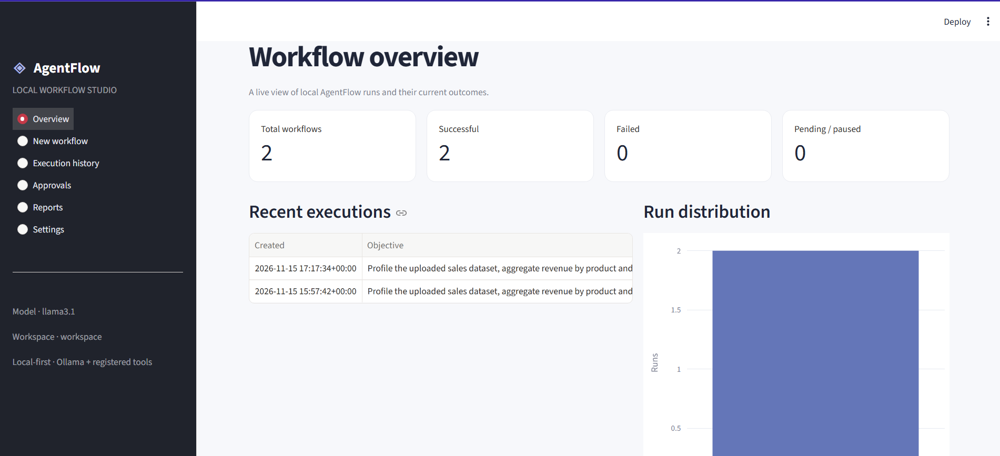
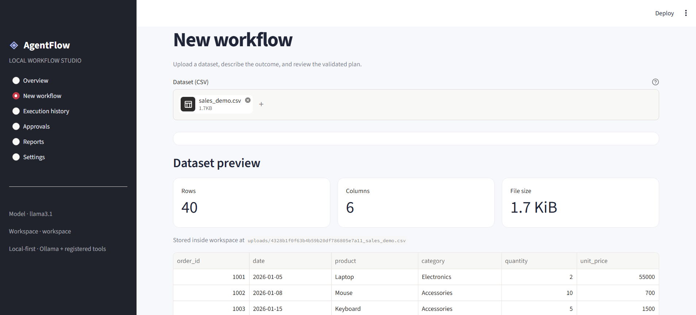
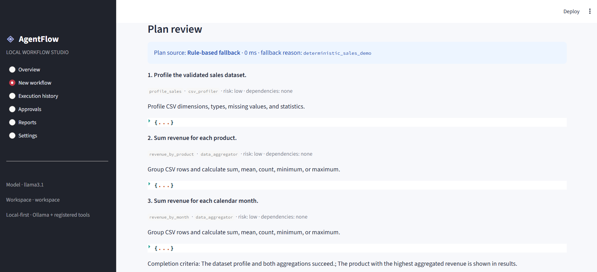
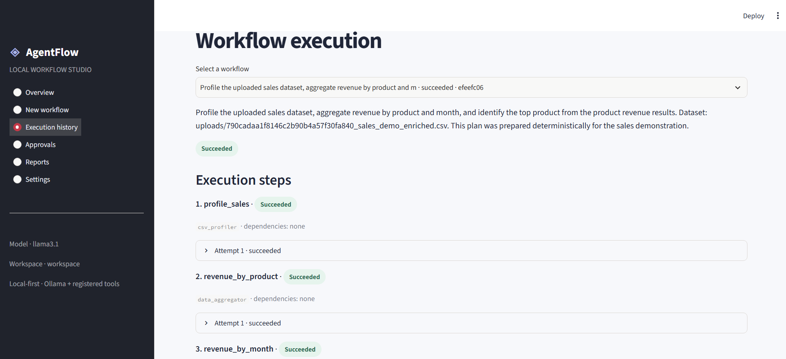
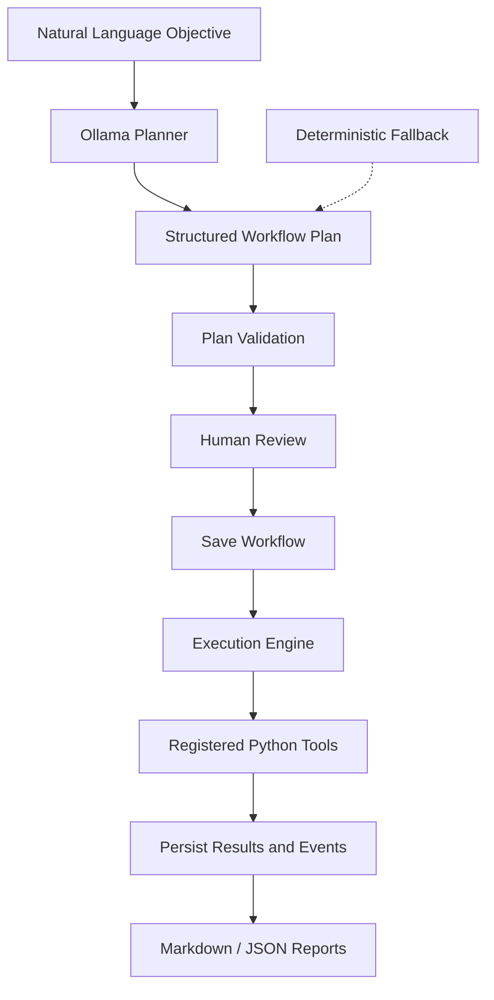

# ⚡ AgentFlow

### From natural-language objectives to controlled, executable workflows.

AgentFlow is a local-first agentic AI workflow orchestration platform that transforms natural-language objectives into structured plans, validates them against registered tools, executes workflows, and generates inspectable reports.

Built with Python, Ollama, SQLite, and Streamlit.

<p align="center">
  
</p>

<p align="center">
  
  
  
  
</p>

<p align="center">
  <b>Local-first AI · Validated planning · Controlled execution · Traceable results</b>
</p>

---

## 🎬 See AgentFlow in Action

**A complete walkthrough of the application:**

[▶ Watch the AgentFlow demo video](assets/agentflow-demo.mp4)

The demo covers dataset upload, workflow planning, plan review, tool execution, and report generation.

---

## 💡 Why AgentFlow?

AI-generated plans should not automatically become executable actions.

AgentFlow separates the responsibility of planning from the responsibility of execution. A local LLM can propose a structured workflow, but the application validates each proposed step against its registered tool catalog before execution.

Rather than executing arbitrary generated code, AgentFlow uses explicitly registered Python functions with validated inputs, controlled execution policies, and persisted results.

**The goal: make AI-driven automation structured, inspectable, and controllable.**

## ✨ Key Features

| Feature | Description |
|---|---|
| 🧠 Local AI Planning | Generate structured workflow plans using Ollama |
| 🛡️ Plan Validation | Validate tool names, parameters, schemas, and dependencies |
| 🔧 Secure Tool Registry | Execute explicitly registered Python functions |
| 🔗 Workflow Execution | Execute validated workflow steps and track outcomes |
| 🔄 Retry Management | Bounded retries for eligible transient failures |
| 👤 Human Approval | Review workflows and manage approval-controlled actions |
| 💾 Persistent History | Store runs, attempts, approvals, and events in SQLite |
| 📊 Data Analysis | Profile CSV files and perform aggregations |
| 📄 Report Generation | Export Markdown and approval-controlled JSON reports |
| 🖥️ Interactive Dashboard | Manage planning, execution, history, approvals, and settings |

## 🖥️ Application Screenshots

### 1. Dashboard Overview

Monitor workflow runs, execution status, and recent activity.


### 2. Dataset Upload and Preview

Upload a CSV dataset and inspect its dimensions, file size, columns, and records.



### 3. Workflow Planning and Review

Inspect the validated workflow plan, registered tools, risk levels, and planning provenance before execution.



### 4. Workflow Execution

Track execution status and inspect the results of registered tools.



---

## 📊 Sales Analytics Demonstration

AgentFlow includes a deterministic sales analytics demonstration that remains usable without a successful Ollama planning request.

**Objective:** Profile the uploaded sales dataset, aggregate revenue by product and month, and identify the highest-revenue product.

### Dataset profile

| Metric | Result |
|---|---:|
| Records | 40 |
| Columns in prepared dataset | 8 |
| Unique products | 5 |
| Missing values | 0 |

### Revenue by product

| Product | Revenue |
|---|---:|
| Laptop | 880,000 |
| Monitor | 240,000 |
| Headphones | 112,500 |
| Keyboard | 79,500 |
| Mouse | 79,100 |

**Highest-revenue product: Laptop**

### Monthly revenue

| Month | Revenue |
|---|---:|
| January 2026 | 270,600 |
| February 2026 | 325,600 |
| March 2026 | 363,300 |
| April 2026 | 431,600 |

All figures are taken from the successful workflow's exported results. The sample dataset does not specify a currency, so values are shown in their original numeric units.

The original uploaded CSV is preserved. The demonstration prepares a separate workspace copy with derived revenue and calendar-month columns before running the registered analysis tools.

## ⚙️ How It Works



### Workflow lifecycle

1. **Describe:** Submit an objective in natural language.
2. **Plan:** Generate a structured plan using Ollama or a supported deterministic fallback.
3. **Validate:** Check proposed tools, parameters, schemas, and dependencies.
4. **Review:** Inspect the proposed workflow before saving.
5. **Execute:** Run the registered tools and track their outcomes.
6. **Inspect:** Review execution history, results, approvals, and reports.

## 🏗️ Architecture

| Module | Responsibility |
|---|---|
| `domain` | Workflow models, validation, and state transitions |
| `storage` | SQLite persistence and database migrations |
| `tools` | Tool registry, contracts, policies, and built-ins |
| `application` | Execution, approval, and reporting services |
| `planning` | Ollama integration, plan validation, deterministic fallback |
| `dashboard` | Streamlit interface and application integration |

### Execution safety

- LLMs produce structured plans, not executable code.
- Plans are validated against registered tools before execution.
- Arbitrary generated Python, shell commands, and SQL are not executed.
- Tool inputs and outputs use explicit validation contracts.
- Workflow attempts and events are persisted.
- Workspace file operations are confined to the configured workspace.

## 🧰 Technology Stack

- **Language:** Python 3.13
- **Local LLM:** Ollama
- **Validation:** Pydantic
- **Database:** SQLite
- **Frontend:** Streamlit
- **Data processing:** Pandas, NumPy
- **Visualization:** Plotly
- **Testing:** Pytest
- **Code quality:** Ruff
- **CI:** GitHub Actions

## 🚀 Getting Started

### Prerequisites

- Python 3.13
- Git
- Ollama (for local LLM planning)

### 1. Clone the repository

```bash
git clone https://github.com/AnannaB/AgentFlow.git
cd AgentFlow
```

### 2. Create a virtual environment

Windows PowerShell:

```powershell
py -3.13 -m venv .venv
.venv\Scripts\Activate.ps1
```

### 3. Install dependencies

```bash
python -m pip install --upgrade pip
python -m pip install -e ".[dev]"
```

### 4. Configure environment variables

```powershell
Copy-Item .env.example .env
```

### 5. Configure Ollama

Install Ollama and download the default model:

```bash
ollama pull llama3.2:1b
ollama list
```

Default configuration:

```env
AGENTFLOW_OLLAMA_BASE_URL=http://localhost:11434
AGENTFLOW_OLLAMA_MODEL=llama3.2:1b
```

You can override the endpoint and model in `.env` or through the dashboard Settings page.

### 6. Launch AgentFlow

```bash
python -m streamlit run src/agentflow/dashboard/app.py
```

Open the local URL displayed in your terminal.

### 7. Run the sales demonstration

1. Open **New workflow**.
2. Upload `examples/sales_demo.csv`.
3. Select **Use deterministic sales demo plan**.
4. Review the validated workflow.
5. Save the reviewed plan.
6. Execute the workflow.
7. Inspect the execution history and reports.

For additional configuration details, see [`docs/setup.md`](docs/setup.md).

## 🧪 Testing

Run the test suite:

```bash
python -m pytest
```

Run linting:

```bash
python -m ruff check .
```

Check formatting:

```bash
python -m ruff format --check .
```

**Latest recorded verification:**

- 160 tests passed
- 2 tests skipped for environment-dependent reasons
- Ruff lint passed
- Ruff formatting passed

The regular test suite does not require a running Ollama server.

## ⚠️ Current Limitations

- Live Ollama `/api/chat` planning was not verified in the development environment because of a Windows socket permission error.
- The deterministic fallback supports a limited set of objectives; the supplied sales demonstration is the reliable end-to-end fallback workflow.
- Browser-level click-through testing has not been verified.
- The dashboard is intended for a trusted local operator and does not currently include user authentication.
- Docker packaging is not currently included.

These limitations are documented to distinguish implemented functionality from features that remain to be verified.

## 🔮 Future Improvements

- Verify live local LLM planning across supported Ollama models.
- Expand deterministic planning capabilities.
- Add richer workflow visualization and execution monitoring.
- Introduce Docker-based deployment.
- Add more built-in tools and workflow templates.
- Improve automated end-to-end dashboard testing.

## 🤝 Contributing

Suggestions, bug reports and contributions are welcome. Feel free to open an issue or submit a pull request.

## 👩‍💻 Author

**Ananna Basak**

Built as an exploration of local-first AI systems, agentic workflows, tool orchestration and reliable automation.

---

<p align="center">
  <b>From planning to execution — with control at every step.</b>
</p>

<p align="center">
  <a href="https://github.com/AnannaB/AgentFlow">Explore AgentFlow on GitHub</a>
  ·
  <a href="https://github.com/AnannaB/AgentFlow/issues">Report an Issue</a>
</p>

<p align="center">
  ⭐ If you find AgentFlow interesting, consider giving the repository a star!
</p>